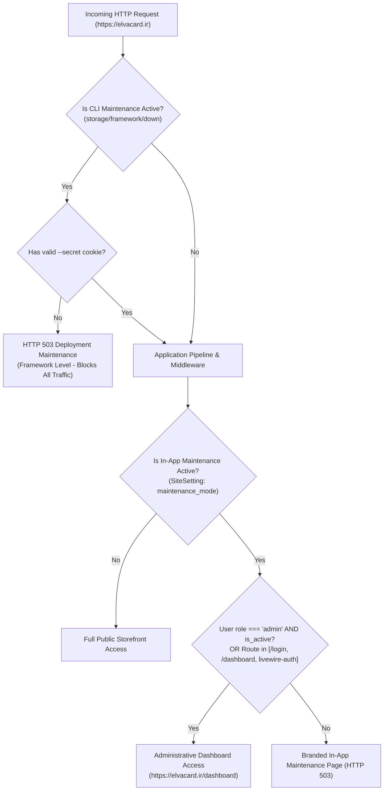

# ElvaCard Production Operations & Update Runbook

This document is the authoritative operational runbook for maintaining, updating, and troubleshooting the existing live ElvaCard production deployment. It combines architectural knowledge, security safeguards, payment incident procedures, and verified host context.

> [!IMPORTANT]
> **Existing Production Installation:**
> This runbook is specifically tailored for updating an **already deployed, active production instance**. It is **not** a generic setup script. Under no circumstances should destructive initial setup commands (such as database reset, key generation, or web root removal) be executed on this environment.

---

## 1. Verified Production Context & Host Topology

The following environment parameters have been verified for the live production server:

| Parameter | Verified Production Setting | Notes & Operational Constraints |
| :--- | :--- | :--- |
| **Canonical Domain** | `https://elvacard.ir` | All links, redirects, and gateway callbacks resolve to this domain. |
| **Application Directory** | `/home/elvacard/elvacard_app` | Application source files reside here (outside the web root). |
| **Web Root (Document Root)** | `/home/elvacard/public_html` | Active web root serving public traffic. **Never delete, overwrite, or unlink.** |
| **Production Database** | `elvacard_prod` | Live production database. Row-level locks (`lockForUpdate`) are active. |
| **Database User** | `elvacard_database_admin` | Dedicated MySQL user with schema privileges on `elvacard_prod`. |
| **Active Deployment Source** | `ElvaCard_Ready` (branch `main`) | Current tracking repository on the server. |
| **Intended Source of Truth** | `card-project` (remote branch `master`) | Development source repository containing all audit reports and tests. |
| **Current Maintenance State** | **ACTIVE** | In-App Administrative Maintenance Mode is currently enabled. |

### Read-Only Hosting Capabilities Audit (Required Prior to Any Change)
Before any operational action or deployment plan is executed, the following server capabilities must be audited using **read-only commands**:

- [ ] **Web Root Connection Method:** Inspect how `/home/elvacard/public_html` routes to `/home/elvacard/elvacard_app/public` (e.g., cPanel DocumentRoot configuration, existing symbolic link, or `.htaccess` rewrite).
  ```bash
  # Check if public_html is a directory or symlink:
  ls -ld /home/elvacard/public_html
  # If it is a directory, inspect its index.php and .htaccess without modifying:
  head -n 20 /home/elvacard/public_html/index.php 2>/dev/null || true
  ```
  **Do not guess, modify, or create new symlinks without an approved, verified migration plan.**

- [ ] **Database Connection & Socket:** Verify actual `DB_HOST` in `.env` using non-secret inspection:
  ```bash
  grep -E '^DB_(CONNECTION|HOST|PORT|DATABASE|USERNAME)=' /home/elvacard/elvacard_app/.env
  ```
  *(Never print or output `DB_PASSWORD` or the entire `.env` file).* Verify connectivity with a read-only query.

- [ ] **CLI Tool Availability & Runtime:**
  ```bash
  which git && git --version
  which composer && composer --version
  which php && php -v
  ```
  *(Verify PHP CLI is running PHP 8.3 with required extensions `pdo_mysql`, `bcmath`, `ctype`, `curl`, `dom`, `fileinfo`, `mbstring`, `openssl`, `tokenizer`, `xml`).*

- [ ] **Active Drivers in Environment:**
  ```bash
  grep -E '^(APP_ENV|APP_DEBUG|SESSION_DRIVER|FILESYSTEM_DISK|LOG_CHANNEL)=' /home/elvacard/elvacard_app/.env
  ```

- [ ] **Storage Symlink Integrity:** Check whether public storage resolves correctly:
  ```bash
  ls -la /home/elvacard/elvacard_app/public/storage 2>/dev/null || true
  ls -la /home/elvacard/public_html/storage 2>/dev/null || true
  ```

- [ ] **Filesystem Identity & Ownership Inspection:**
  Inspect the running user, group, and active directory permissions without modifying:
  ```bash
  id -u -n && id -g -n
  ls -ld /home/elvacard/elvacard_app
  ls -ld /home/elvacard/elvacard_app/storage /home/elvacard/elvacard_app/bootstrap/cache
  ```

---

## 2. Mandatory Production Safety Guardrails

The following rules are non-negotiable and must be enforced during all operational and maintenance procedures:

### Rule 1: Zero Overwrite of `.env` or `APP_KEY`
- The live environment file `/home/elvacard/elvacard_app/.env` contains production credentials, gateway parameters, and the active `APP_KEY`.
- **STRICT PROHIBITION:** Never execute `php artisan key:generate` on an existing installation. Generating a new key permanently destroys decryption of existing encrypted database columns, invalidates all active user sessions, and corrupts signed URLs.
- **STRICT PROHIBITION:** Never overwrite or replace the production `.env` with `.env.example` or any staging configuration.
- Any inspection of `.env` must be targeted to non-sensitive keys to avoid exposing secrets in logs or terminal outputs.

### Rule 2: Web Root & Filesystem Protection
- **STRICT PROHIBITION:** The dangerous instruction `rm -rf public_html` is **permanently eliminated**. Never propose or execute commands that delete, replace, or unlink the existing web root.
- Any change to how `public_html` serves assets requires an independently reviewed, separately approved migration plan.

### Rule 3: Database & Customer Data Protection
- **STRICT PROHIBITION:** Never run `migrate:fresh`, `migrate:reset`, or `migrate:rollback` blindly.
- **STRICT PROHIBITION:** Never run `db:seed` or call seeders on production. While `DatabaseSeeder::run()` explicitly throws an exception in production, individual seeder classes (such as `StoreCatalogSeeder`) do not share this safeguard if invoked directly. Running seeders on production risks data corruption or duplicate records.
- **STRICT PROHIBITION:** Automated test suites (`php artisan test` or `./vendor/bin/phpunit`) must **never** be executed against the live database `elvacard_prod`.
- All user-uploaded files, receipts, card design snapshots, and custom textures stored in `storage/app/` must be preserved intact.

### Rule 4: Maintenance Mode Preservation & Gatekeeper Policy
- Application Maintenance Mode is currently active.
- Do not issue `php artisan up` or disable maintenance mode automatically.
- Public launch and opening the storefront to guest traffic is strictly gated behind **explicit human approval**.

### Rule 5: No Blind Git Pulls or History Merging
- Production currently tracks `ElvaCard_Ready` (`main`), whereas development occurs in `card-project` (`master`).
- Do not run `git pull origin main` or attempt to merge diverging git histories directly on the server.
- Repository reconciliation and release-source selection must be formally completed and packaged before deployment.

---

## 3. Pre-Deployment Backup & Verification Procedure

Every deployment or system maintenance event requires a verified snapshot stored **completely outside the public web root** in a protected directory (e.g., `/home/elvacard/backups/`).

> [!IMPORTANT]
> **Data Consistency Note:**
> Because In-App Administrative Maintenance Mode permits authenticated staff administrators to access the dashboard and perform operations (such as reviewing manual payments, updating orders, or modifying catalog settings), database and storage snapshots must be taken concurrently to maintain cross-system consistency.

```bash
# Ensure backup directory exists with restricted access (owner only)
mkdir -p /home/elvacard/backups
chmod 700 /home/elvacard/backups
```

### Step 1: Database Snapshot Creation & Verification
Export the full database schema and data using transaction-safe dumping:
```bash
mysqldump -u elvacard_database_admin -p \
  --single-transaction \
  --quick \
  --triggers \
  --routines \
  elvacard_prod | gzip > /home/elvacard/backups/db_backup_pre_update_$(date +%Y%m%d_%H%M%S).sql.gz
```
**Verification Check:**
- Ensure the resulting `.sql.gz` file is non-empty (`ls -lh /home/elvacard/backups`).
- Test archive integrity without decompressing to disk:
  ```bash
  gzip -t /home/elvacard/backups/db_backup_pre_update_*.sql.gz
  ```
- Inspect dump header to confirm schema completeness:
  ```bash
  zcat /home/elvacard/backups/db_backup_pre_update_*.sql.gz | head -n 30
  ```

### Step 2: Storage Attachments & Uploaded Data Snapshot
Order attachments, custom design previews, and customer payment receipts reside in `storage/app` (including `storage/app/receipts`, `storage/app/private`, and `storage/app/public`). A database restore without matching storage files causes fatal discrepancies.
```bash
tar -czf /home/elvacard/backups/storage_app_backup_$(date +%Y%m%d_%H%M%S).tar.gz \
  -C /home/elvacard/elvacard_app storage/app
```
**Verification Check:**
- Test tar archive integrity:
  ```bash
  tar -tzf /home/elvacard/backups/storage_app_backup_*.tar.gz | head -n 20
  ```
- Confirm non-zero byte size and inclusion of `storage/app/`.

### Step 3: Current Environment & Release Identity Snapshot
```bash
# Backup existing active .env (preserving permissions and timestamp)
cp -p /home/elvacard/elvacard_app/.env /home/elvacard/backups/.env_backup_$(date +%Y%m%d_%H%M%S)

# Record active release state (commit hash if git repo, or release metadata)
if [ -d "/home/elvacard/elvacard_app/.git" ]; then
  git -C /home/elvacard/elvacard_app rev-parse HEAD > /home/elvacard/backups/release_commit_pre_update.txt
else
  echo "Non-git deployment directory at $(date)" > /home/elvacard/backups/release_commit_pre_update.txt
fi
```

---

## 4. Maintenance Mode Architecture & Management

ElvaCard utilizes two distinct maintenance layers. It is critical to differentiate their interaction:



### 1. In-App Administrative Maintenance Mode
- **Status:** **CURRENTLY ACTIVE on Production.**
- **How it works:** Managed via Admin Dashboard (`SiteSettingManager`), stored in database table `site_settings` (`key: 'maintenance_mode'`), and memoized at `storage/framework/maintenance_mode.json`.
- **Routing:** Enforced by `App\Http\Middleware\CheckMaintenanceMode`.
  - Authenticated staff administrators (`role === 'admin'` and `is_active === true`) have **unrestricted access** to the store backend.
  - Essential routes (`/login`, `/dashboard`, and dynamic Livewire auth endpoints) remain accessible.
  - Public guest visitors receive a branded HTTP 503 page.
- **Operational Rule:** **Keep this mode active throughout updates.** Only disable it when final sign-off is granted by the system owner.

### 2. Laravel CLI Maintenance Mode
- **Status:** Inactive during normal operations; used **conditionally** during migrations or file synchronization.
- **Critical Interaction with Admin Access & Livewire:**
  - When CLI maintenance (`php artisan down`) is activated, Laravel intercepts traffic at the early HTTP kernel bootstrap level before any route or session is booted.
  - **All requests—including admin login, dashboard navigation, and Livewire component updates—will return HTTP 503** unless the request carries a valid bypass cookie set via `--secret`.
  - Therefore, CLI maintenance must **not** be activated routinely or left on unattended. If needed during file or schema changes, operators must generate a bypass secret:
    ```bash
    php artisan down --secret="deployment-bypass-token-$(date +%s)"
    ```
    and access the bypass URL `https://elvacard.ir/<deployment-bypass-token>` to enable administrative and Livewire access during testing.
- **Operational Rule:** Do **not** execute `artisan down` or `artisan up` blindly. Use CLI maintenance only if an active schema alteration or file replacement would cause runtime errors for concurrent admin sessions.

---

## 5. Known Production Issue: Bank Card & Fuel Card Designers

> [!WARNING]
> **Known Production Defect:**
> On the live site, navigating to the **Bank Card Designer** (`/design/bank`) or **Fuel Card Designer** (`/design/fuel`) redirects to `/dashboard` and subsequently returns `HTTP 404 Not Found`.
> **This issue must be diagnosed, fixed, and verified under maintenance bypass prior to opening the site to the public.**

### Diagnostic Hypotheses & Read-Only Investigation Protocol
The operator must investigate using read-only techniques across multiple hypotheses without modifying live data:

#### Hypothesis 1: Missing or Inactive Product Records in Database
In `App\Http\Controllers\CustomDesign\CustomDesignController`:
- The `bank()` method queries:
  `Product::query()->active()->purchasable()->where('customization_workflow', CustomizationWorkflowEnum::BANK_CARD->value)->first()`
- The `fuel()` method queries:
  `Product::query()->active()->purchasable()->where('customization_workflow', CustomizationWorkflowEnum::FUEL_CARD->value)->first()`
- If matching active/purchasable product records do not exist, both methods execute `abort(404)`.

**Read-Only Verification Check (Inspect only necessary fields for relevant workflows):**
```sql
SELECT id, name, customization_workflow, is_active, is_purchasable
FROM products
WHERE customization_workflow IN ('bank_card', 'fuel_card');
```

#### Hypothesis 2: Maintenance Middleware & Authentication Redirection
- When In-App Maintenance Mode is active, `CheckMaintenanceMode` intercepts unauthenticated requests to `/design/*` and returns 503.
- If an application component, header redirect, or login check erroneously redirects guest traffic to `/dashboard`, unauthenticated visitors are redirected to `/login`, or authenticated non-admin sessions yield 404/redirects.

#### Hypothesis 3: Template Link & Navigation Target Discrepancies
- Navigation links or hero buttons in Blade templates may incorrectly link to `/dashboard/...` instead of public routes `route('custom-card.bank')` and `route('custom-card.fuel')`.
- Read-only inspection of templates:
  ```bash
  grep -rn "custom-card" resources/views/
  grep -rn "design/bank" resources/views/
  grep -rn "design/fuel" resources/views/
  ```

#### Hypothesis 4: Route Registration & Web Server Rewrite Rules
- Read-only route verification:
  ```bash
  php artisan route:list --name=custom-card
  ```
- Inspect HTTP response headers and redirect chains with read-only probe:
  ```bash
  curl -s -I -L https://elvacard.ir/design/bank
  curl -s -I -L https://elvacard.ir/design/fuel
  ```

---

## 6. Execution Procedure: Updating the Existing Production Installation

This procedure outlines the reviewed deployment workflow for updating `/home/elvacard/elvacard_app`.

### Phase A: Pre-Deployment Verification & Backups
1. Complete the Read-Only Host Audit (Section 1).
2. Execute the full database and storage backup (Section 3).
3. Confirm repository reconciliation: Verify which commit/branch from `ElvaCard_Ready` or `card-project` is being deployed. Do not perform blind merges or pulls directly on the production host.

### Phase B: Conditional Maintenance Window (If Required)
If the release contains schema migrations or breaking file updates that cannot be applied atomically:
```bash
cd /home/elvacard/elvacard_app
php artisan down --secret="elva-deploy-$(date +%s)"
```
*(Record the bypass secret output. Access `https://elvacard.ir/<secret>` in your browser to maintain admin and Livewire access).*

### Phase C: Code Update (Planned Release Sync)
1. Deploy updated code using the approved release packaging method or fast-forward pull:
   ```bash
   # Verify working tree status:
   git status --short
   # Only if working tree is clean and deployment method is Git:
   git pull --ff-only origin <approved-release-branch>
   ```
2. **Frontend Build Verification:**
   Ensure precompiled frontend assets are in place. Shared hosting does not run Node.js/Vite:
   - Check `public/build/manifest.json` exists.
   - Check `public/build/assets/` contains compiled CSS and JS.
   - Confirm `public/hot` does **not** exist.

### Phase D: PHP Dependencies Update
```bash
composer install --no-dev --optimize-autoloader
```
*Verify exit code is `0` and `vendor/autoload.php` is updated.*

### Phase E: Database Schema Update
1. Check migration status before running:
   ```bash
   php artisan migrate:status
   ```
2. Run pending migrations only after backup confirmation:
   ```bash
   php artisan migrate --force
   ```
   > [!CAUTION]
   > Do **not** run seeders or fresh migrations.

### Phase F: Cache Rebuilding & Compatibility Verification
> [!WARNING]
> **Route Cache Compatibility Caution:**
> Do not assume `route:cache` will succeed automatically. If any route contains closures or incompatible bindings, `route:cache` will fail and break the application. Always verify:

```bash
# 1. Clear existing caches
php artisan optimize:clear

# 2. Re-cache Configuration
php artisan config:cache

# 3. Cache Routes (with immediate check and fallback)
php artisan route:cache || php artisan route:clear

# 4. Cache Blade Templates
php artisan view:cache

# 5. Cache Events & Listeners
php artisan event:cache
```

### Phase G: Post-Deployment Smoke Testing (Under Bypass)
Access `https://elvacard.ir/<your-secret-bypass-key>`:
1. **Admin Authentication:** Log in at `https://elvacard.ir/login` and verify `/dashboard`.
2. **Designer Flows:** Test `/design/bank` and `/design/fuel` (confirm resolution of known 404 issue).
3. **Cart & Checkout:** Add item to cart and verify checkout address form.
4. **Manual Payment:** Test card-to-card receipt upload flow.
5. **Logs Check:** Check active application log without assuming a single fixed filename:
   ```bash
   # Inspect available logs in storage/logs/:
   ls -la /home/elvacard/elvacard_app/storage/logs/
   # Tail the most recent log file:
   tail -n 50 /home/elvacard/elvacard_app/storage/logs/$(ls -t /home/elvacard/elvacard_app/storage/logs/ | head -n 1)
   ```

### Phase H: Restoring to In-App Maintenance State
If CLI maintenance mode was enabled during Phase B, exit it once technical verification passes:
```bash
php artisan up
```
*(The site remains protected under **In-App Administrative Maintenance Mode** until the final launch decision).*

---

## 7. Storage, Permissions & Web Root Integrity

### Narrowest Justified Permissions Model
**Do not execute blanket recursive permissions (`chmod -R 775` or `chown -R`) across the application.** Hosting environments under CloudLinux (CageFS), LiteSpeed (LSPHP), or suPHP enforce strict permission policies; overly permissive modes (like group-writable code files) can trigger HTTP 500 errors.

1. **Read-Only Inspection First:**
   Verify current user, group, and permissions:
   ```bash
   id -u -n && id -g -n
   ls -ld /home/elvacard/elvacard_app/storage /home/elvacard/elvacard_app/bootstrap/cache
   ```
2. **Targeted Write Permissions (Only if Required):**
   Only adjust permissions if the application encounters runtime write failures (`EACCES` / permission denied):
   ```bash
   # Narrowly target runtime writable directories only:
   chmod -R 775 /home/elvacard/elvacard_app/storage
   chmod -R 775 /home/elvacard/elvacard_app/bootstrap/cache
   ```
   *(If the hosting PHP handler is suPHP/LSPHP running as the account owner, `755` is standard and sufficient; do not change if already functioning).*
3. **Sensitive File Protection:**
   ```bash
   chmod 600 /home/elvacard/elvacard_app/.env
   ```
4. **Ownership:**
   Do not attempt `chown` commands. Standard cPanel accounts do not possess root privileges to change file ownership. Files uploaded or cloned under the account automatically inherit the cPanel user ID.

### Preserving Web Root (`public_html`)
- The active web root `/home/elvacard/public_html` must remain structurally intact.
- If assets are served via a symbolic link (`public_html -> elvacard_app/public`), verify the link with `ls -la /home/elvacard/public_html`.
- If assets are served via `.htaccess` or cPanel document root mapping, confirm files in `public_html` match the latest `public/` build.
- **Never delete or unlink `public_html`.**

---

## 8. Observability & Payment Incident Runbook

### Verified Application Audit Logging
Critical payment and order lifecycle events emit structured context to the application log:
- **Gateway Initiation:** `Gateway provider exception during payment initiation` (error), `Gateway initiation rejected` (warning) — in `GatewayInitiationService`.
- **Gateway Verification:** `Gateway payment success` (info), `Gateway verification failed` (warning), `Gateway verification amount mismatch` (warning), `Gateway provider exception during payment verification` (error) — in `GatewayPaymentCore`.
- **Manual Payment Reviews:** `Manual payment approved` (info), `Manual payment rejected` (warning) with `reviewed_by` admin ID and timestamp — in `ManualPaymentReviewService`.
- **Order State Transitions:** `Order status changed` (info) with `from`, `to`, and `actor_id` — in `OrderStateMachine`.

### Log File Inspection
Do not assume a single hardcoded log file exists. Check directory contents:
```bash
ls -la /home/elvacard/elvacard_app/storage/logs/
```
If logging to daily files (e.g. `laravel-YYYY-MM-DD.log`), monitor the current day's log:
```bash
tail -f /home/elvacard/elvacard_app/storage/logs/$(ls -t /home/elvacard/elvacard_app/storage/logs/ | head -n 1) | grep -E "payment|order|exception"
```

### Payment Incident Protocols

| Incident Signature | Probable Cause | Action Protocol |
| :--- | :--- | :--- |
| **`provider_exception`** | Network timeout, SSL failure, or provider gateway outage during callback. | Payment is marked `FAILED` with `metadata.reason = provider_exception`. The callback returns controlled `{"status":"failed"}` (prevents HTTP 500). Inspect order in Admin Panel, check provider merchant portal to see if money was deducted. If deducted, initiate reconciliation or refund. |
| **`amount_mismatch`** | Callback amount does not equal local order total (e.g. Rial vs Toman conversion mismatch). | **Never auto-approve.** Payment is held. Review provider transaction logs to verify the actual deposited amount before taking manual administrative action. |
| **`provider_verification_failed`** | Provider verification API returned non-zero error code. | Cardholder aborted, OTP expired, or card rejected. Order remains `pending_payment`. Notify customer to retry with another card. |
| **Manual Receipt Dispute** | Uploaded card-to-card receipt invalid, blurred, or uncredited. | Admin rejects payment via `/dashboard/orders/{order}`. Rejection writes `reviewed_by` and reason to metadata. Contact customer via phone. |

> [!CAUTION]
> Never disclose or commit payment gateway merchant IDs, passwords, or terminal keys. All gateway credentials must reside exclusively in `/home/elvacard/elvacard_app/.env`.

---

## 9. Emergency Restoration & Disaster Recovery Protocols

> [!CAUTION]
> **Emergency Restoration Warning:**
> Restoring a database snapshot into the live production database is **not** a routine rollback step. Overwriting `elvacard_prod` with a previous dump will permanently wipe all administrative actions, orders, manual payment approvals, and customer state changes that occurred after the backup was captured.

Before initiating any database or storage restore:
1. **Assess Post-Backup Activity:** Query the database for records created since the backup:
   ```sql
   SELECT COUNT(*) FROM orders WHERE created_at >= '<backup-timestamp>';
   SELECT COUNT(*) FROM payments WHERE updated_at >= '<backup-timestamp>';
   ```
2. **Obtain Approved Recovery Target:** Define an explicit recovery plan agreed upon with system administrators.
3. **Capture a Pre-Restore Safety Snapshot:** Always take a current snapshot of the damaged state before overwriting anything.

### Emergency Database Restoration (Under Approved Recovery Plan)
```bash
gunzip < /home/elvacard/backups/db_backup_pre_update_<timestamp>.sql.gz | \
  mysql -u elvacard_database_admin -p elvacard_prod
```

### Emergency Storage Attachments Restoration
```bash
tar -xzf /home/elvacard/backups/storage_app_backup_<timestamp>.tar.gz \
  -C /home/elvacard/elvacard_app/
```

### Emergency Environment Configuration Restoration
```bash
cp -p /home/elvacard/backups/.env_backup_<timestamp> /home/elvacard/elvacard_app/.env
```

### Release Rollback Policy
- **Do not assume `git checkout <previous-commit>` is a complete rollback.**
- If deployed via release packaging or directory switching, revert the pointer/symlink to the previous audited release package.
- If deployed via Git on a clean working tree:
  ```bash
  # Check working tree cleanliness first:
  git -C /home/elvacard/elvacard_app status --short
  # Revert to verified commit hash only after confirming tree is clean:
  git -C /home/elvacard/elvacard_app checkout <previous-verified-commit>
  ```
- Re-run dependency and cache adjustments:
  ```bash
  composer install --no-dev --optimize-autoloader
  php artisan optimize:clear
  php artisan config:cache
  php artisan view:cache
  ```

---

## 10. Appendix: Reference for Fresh Installations Only

> [!NOTE]
> This section is strictly for setting up a brand-new, empty secondary environment or disaster-recovery staging server. **Do NOT run these commands on the live production host.**

```text
[REFERENCE ONLY - NOT FOR LIVE HOST]
1. Clone repository to /home/<user>/<app_dir>
2. cp .env.example .env && chmod 600 .env
3. composer install --no-dev --optimize-autoloader
4. php artisan key:generate  <-- ONLY ON EMPTY NEW DATABASE
5. php artisan migrate --force
6. php artisan storage:link
7. php artisan tinker (create initial admin via firstOrCreate)
8. php artisan config:cache && php artisan route:cache && php artisan view:cache
```

---

## 11. Final Launch Gate & Sign-Off Checklist

Before disabling In-App Maintenance Mode and opening `https://elvacard.ir` to the general public, all items below must be explicitly verified:

- [ ] **Database & Storage Backups Verified:** Pre-update snapshot confirmed readable, non-empty, and safely stored in `/home/elvacard/backups/`.
- [ ] **Environment Hardening:** `APP_ENV=production`, `APP_DEBUG=false`, `APP_URL=https://elvacard.ir`, `SESSION_SECURE_COOKIE=true`.
- [ ] **Static APP_KEY:** Confirmed unmodified; encryption operational.
- [ ] **Migrations Applied:** `php artisan migrate:status` shows all migrations `[Ran]`. No data lost.
- [ ] **Frontend Bundles:** Precompiled CSS/JS present in `public/build`; `manifest.json` valid; `public/hot` absent.
- [ ] **Designer Workflows Diagnosed & Operational:**
  - [ ] `/design/bank` loads without redirecting to `/dashboard` or returning 404.
  - [ ] `/design/fuel` loads without redirecting to `/dashboard` or returning 404.
- [ ] **Administrative Access:** Admin can authenticate at `/login` and operate `/dashboard`.
- [ ] **Checkout & Payment:** Cart flow, address submission, and manual payment receipt upload operational.
- [ ] **Error Logs Clean:** No uncaught exceptions in active logs.
- [ ] **Explicit Human Launch Authorization:** Formal sign-off granted by system owner.
- [ ] **Public Launch:** Disable In-App Maintenance Mode via Admin Panel (`SiteSettingManager`) or Tinker.
